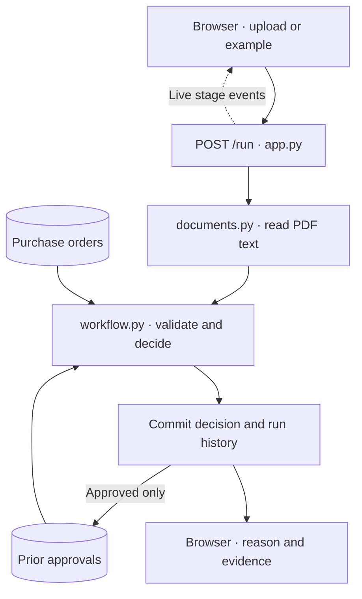

# PS-1 · How the invoice review desk makes a decision

An invoice for ₹35,000 arrives against a ₹1,00,000 purchase order (PO). Should accounts payable approve it? The PDF alone cannot answer that. The company has already approved ₹70,000 against the order, leaving ₹30,000 available. This invoice exceeds the balance by ₹5,000. The correct output is **Hold**, along with the figures that let an analyst verify the decision.

That example explains the design of **Ledger Review**. Three sources answer three different questions:

| Source | Question it answers |
|---|---|
| The invoice PDF | What is the vendor asking for? |
| The procurement register (POs) | What did the company authorise, and to whom? |
| The approval ledger | How much of that authorisation is still available? |

## 1. Architecture at a glance

A single Python server serves the browser interface, reads PDFs and executes the decision rules. SQLite holds the purchase orders, approvals and run history. Everything needed for a demo runs locally in one process, without API keys.

| Where to look in the ZIP | What it owns | Why it matters |
|---|---|---|
| `web/ui.js` | Uploads, the live run view (streamed stages), decision detail and the history dashboard | An analyst can see which checks ran and reopen the evidence later. |
| `app.py` → `run()` | Runs extraction, opens a database transaction, invokes the decision function and saves the result | An approval and its history entry commit together or not at all. |
| `documents.py` → `read_document()`, `field()` | Reads the PDF text layer and finds values under supported field labels | A better extraction method can replace this later without touching the decision rules. |
| `workflow.py` → `prepare()`, `decide()` | Maps text to invoice fields, validates them, checks prior approvals and chooses an outcome | The business policy has one place to inspect and test. |
| `samples/procurement.json` | Seeds the demo purchase orders and opening approval | A fresh workspace starts with a known, reproducible balance. |
| `test_workflow.py` | Exercises approvals, split invoices, duplicates, ambiguity, unreadable files, persistence and concurrency | Includes two concurrent submissions of the same invoice, and two different invoices competing for one balance. |

## 2. Follow one PDF through the system

1. **Receive the input.** The browser sends a PDF as base64 inside a JSON request to `POST /run`. Selecting a prepared example loads a bundled PDF through the same reader. If both are supplied, the uploaded file wins. Files above the size limit, or that are not PDFs, are rejected as input errors before any run is recorded.
2. **Extract the vendor's claim.** The reader uses `pypdf` to extract text. The workflow looks for vendor, invoice number, invoice date, PO reference and gross total. It recognises alternative labels such as `Supplier` for `Vendor` and `Amount due` for `Grand total`. If two recognised labels give different values for the same field, the field is marked ambiguous instead of picking one.
3. **Consult the ledger.** Once extraction finishes, the server opens a write transaction. The decision function evaluates the rules below in order. A check can end the run early, so a duplicate is blocked before any balance is calculated.
4. **Return an explanation.** The server streams each stage as a newline-delimited JSON event, which drives the live run view. It saves the final status, reason, extracted fields, decision evidence and stage trace. The dashboard reopens the latest 100 runs through `GET /history`. Uploaded PDF bytes are processed in memory and not stored.

## 3. The decision rules, in execution order

| # | Check | Outcome when the check stops the run | Rationale |
|---|---|---|---|
| 1 | Can the document be read, and are the required fields usable? | **Hold** for an unreadable or image-only document, conflicting PO references, missing vendor/number/date/total, an invalid date, or an amount that cannot be parsed. | A guess about a vendor or amount could debit the wrong order. |
| 2 | Has this vendor's invoice number already been approved? | **Duplicate blocked**, with the earlier approval reference and amount shown side by side. | A vendor can rename and resend a file. The business identifier survives the rename. |
| 3 | Can the invoice be assigned to exactly one of this vendor's POs? | **Hold** for an unknown vendor, an explicit PO that belongs to another vendor, or several possible orders (the candidates are listed). | An explicit PO must belong to the vendor. With no reference, a single open candidate is enough under the demo policy. |
| 4 | Does the invoice fit the remaining balance? | **Hold** with the excess amount. | Several invoices can legitimately draw on one order. Each earlier approval consumes part of the ceiling. |
| ✓ | All checks pass | **Approved**. Insert the approval and return the new available balance. | An invoice equal to the remaining balance is valid and leaves zero available. |

**Precise definitions**

- **Duplicate key:** vendor name in uppercase with repeated whitespace collapsed, plus the trimmed, uppercased invoice number. Only *approved* invoices count, so a held invoice can be corrected and resubmitted.
- **Money:** amounts are parsed with decimal arithmetic and stored as integer paise, so there is no floating-point rounding.
- **Balance:** `PO ceiling − sum of approved amounts for that PO`.
- **Tolerance:** zero. An invoice even ₹1 over the balance is held. This is a deliberate choice for a prototype that cannot yet see goods receipts or tax lines; see section 6.

## 4. What the database protects

| SQLite table | Stored facts | Role in the decision |
|---|---|---|
| `orders` | PO identifier, vendor and ceiling in paise | Establishes ownership and the authorised ceiling. |
| `approvals` | Vendor, invoice number, PO, approved amount and reference | Supplies the amounts already consumed. The composite primary key (vendor, invoice number) makes a second approval impossible even if the application check were bypassed. |
| `runs` | Run ID, UTC timestamp and JSON decision record | Preserves every explanation, including holds and duplicate blocks that leave the balance unchanged. |

**Why a transaction?** Suppose two different ₹20,000 invoices arrive together when ₹30,000 remains. If both requests read ₹30,000 independently and then approve, the company overcommits by ₹10,000. `BEGIN IMMEDIATE` serialises decisions within one workspace: the first approval leaves ₹10,000, and the second request reads that updated figure and holds its invoice. PDF reading happens before the transaction, so slow documents never hold the write lock.

**Workspaces.** A browser cookie selects a workspace-specific SQLite database. Refreshing keeps the same ledger; a fresh private browsing session starts again from the seed data. This matters in a demo because the order of runs changes the arithmetic. A real deployment would use one shared ledger with authenticated reviewers.

## 5. Edge cases I designed

The brief asks for 2–4 realistic edge cases where the process must behave differently from the happy path. These are mine, and each one targets a specific way AP goes wrong.

| Edge case | What could go wrong without it | What Ledger Review does |
|---|---|---|
| **Invoice exceeds the remaining PO balance** (₹35,000 against ₹30,000 left) | Checking against the PO total (₹1,00,000) instead of what remains would approve it and overspend the order. | Holds it and shows ₹5,000 excess with the full arithmetic. |
| **The same invoice sent again under a new file name** | A file-name or file-hash check misses it, and the vendor is paid twice. | Blocks it by vendor + invoice number and shows the earlier approval reference. |
| **One PO split across several invoices, in different layouts** | A rule of "one invoice per PO" would wrongly hold valid instalments. | Approves each instalment while the balance allows, reading alternate labels. |
| **No PO reference, and the vendor has two open POs** | Guessing an order debits the wrong budget. | Holds and lists both candidate POs for procurement to confirm. |

A scanned, image-only PDF is a fifth case: it is held with a request for a text-based copy rather than guessed.

## 6. A reproducible demo

Start in a fresh private browser session. Run the examples **in this order** so the balances match the table.

| Step | Example | Expected decision | PO-410 balance afterwards |
|---|---|---|---:|
| 0 | Opening ledger | ₹1,00,000 ceiling less ₹70,000 already approved | ₹30,000 |
| 1 | Exceeds remaining balance · ₹35,000 | **Hold**. Show the ₹5,000 excess. | ₹30,000 |
| 2 | Clean partial invoice · ₹25,000 | **Approved**. Show the arithmetic and the invoice number. | ₹5,000 |
| 3 | Renamed copy of the clean invoice | **Duplicate blocked**. Show the earlier approval reference. | ₹5,000 |
| 4 | Alternate layout · ₹4,500 | **Approved**. A second valid instalment on the same PO. | ₹500 |
| 5 | No PO reference, Aster Supplies | **Hold**. Two candidate orders listed. | unchanged |
| 6 | Image-only PDF | **Hold**. Request a text-based copy. | unchanged |

## 7. Design choices and limits

- **Why explicit rules instead of a model for the decision?** "Has this been approved?" and "How much remains?" have exact answers in stored records. A deterministic rule gives the same answer every time and can be checked by an analyst. The decision makes no model calls.
- **Where AI would help.** Extraction is the weak point: the reader supports text-based PDFs with recognised labels, so unfamiliar layouts can miss fields and scans go to review. The next step is an OCR or LLM extraction stage that returns candidate values with the page text it found them in, for a reviewer to confirm. The same duplicate and balance rules would then run on confirmed values, so the decision stays verifiable.
- **Tax and totals.** The prototype compares the invoice's gross total with a PO ceiling stated on the same basis, in INR. If a PO were stated before GST, gross invoices would need to be converted first. Line-item matching, tax reconciliation, goods-receipt (three-way) matching and payment are out of scope.
- **Tolerance.** Real AP teams often allow a small overage (for example rounding or freight) to be approved or routed for sign-off. The prototype uses zero tolerance so every approval is strictly within budget; a configurable threshold is a small, contained change to rule 4.
- **Vendor identity.** Matching is on the normalised vendor name. Names written differently (for example "Aster Supplies Pvt Ltd" and "Aster Supplies") are treated as different vendors. A production system would match on a vendor ID or GSTIN from the vendor master.
- **After a hold.** The analyst sees the reason and can submit a corrected document as a new run. There is no manual override or linked correction case yet. A missing upload or invalid request is an input error and does not create a decision record.

**In one breath:** "The hardest part was deciding when the system had enough evidence to approve. I used the PDF for the vendor's claim, the PO for the authorised amount and prior approvals for the remaining balance. If the order is ambiguous, the tool shows the candidates instead of guessing. If the invoice is approved, it records the decision and consumes the balance in the same transaction, so two invoices can never spend the same money."
